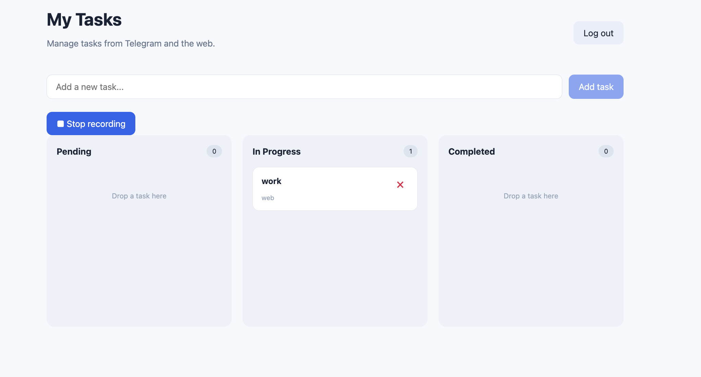
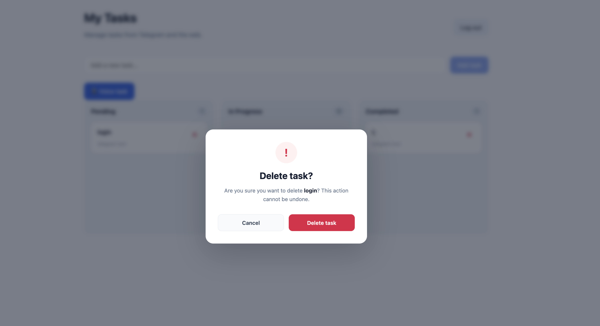
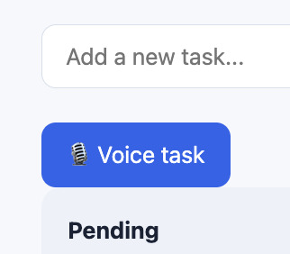
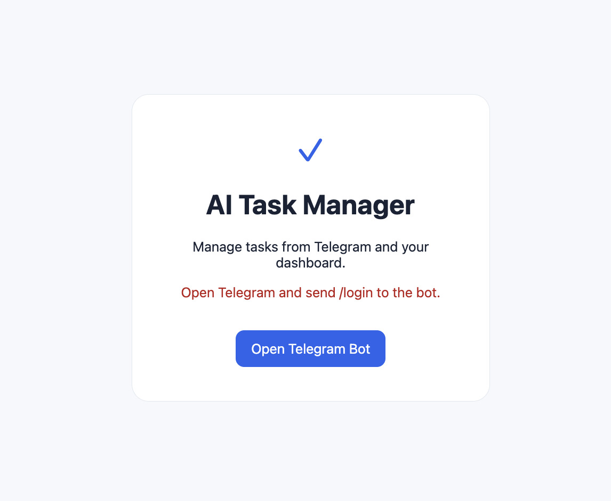

# AI Task Bot

**Omni-channel task management with Telegram, OpenAI voice transcription, FastAPI, React, PostgreSQL, Redis, and Celery.**

Create tasks using Telegram text or voice messages and manage them in a web dashboard. Telegram voice transcription is processed asynchronously, and task changes are delivered to connected dashboards in real time.

## Features

### Telegram bot

- Create a task by sending a text message.
- Create a task from a Telegram voice message using OpenAI transcription.
- Receive success and failure notifications.
- Sign in to the web dashboard using an expiring, single-use `/login` link.
- Avoid duplicate task creation when Telegram messages are delivered more than once.

### Web dashboard

- React and TypeScript interface with a responsive Kanban board.
- **Pending**, **In Progress**, and **Completed** columns.
- Drag and drop to update task status.
- Create, inspect, and delete tasks, with confirmation before deletion.
- Real-time updates through WebSockets and Redis Pub/Sub.
- User-specific task access through authenticated sessions.

**Kanban dashboard**



**Task deletion confirmation**



### Browser microphone 

The frontend includes a microphone control that records browser audio using `MediaRecorder` and submits it as a multipart upload. This uses a separate authenticated `POST /api/v1/tasks/voice` endpoint rather than Telegram file IDs.




### Reliability

- PostgreSQL persistence with SQLAlchemy and Alembic migrations.
- Redis-backed Celery queue for Telegram voice transcription.
- Celery Beat scheduling for recovery of interrupted voice jobs.
- Atomic job claims, leases, lease renewal, and stale-worker protection.
- Retry handling and explicit failure reporting, including OpenAI quota errors.
- Automated backend tests and GitHub Actions CI.

## Technology stack

| Area | Technology |
| --- | --- |
| Backend / API | Python, FastAPI, SQLAlchemy |
| Telegram integration | aiogram |
| Database / migrations | PostgreSQL, Alembic |
| Background processing | Celery, Celery Beat, Redis |
| Voice transcription | OpenAI API |
| Frontend | React, TypeScript, Vite, dnd-kit |
| Real-time updates | WebSockets, Redis Pub/Sub |
| Frontend web server | Nginx |
| Containerization | Docker Compose |
| Tests / CI | pytest, GitHub Actions |

## Architecture

```text
Telegram text ──> aiogram bot ──────────────> PostgreSQL
                    │                              │
Telegram voice ─────┘                              │
                    │                              │
                    └─> Redis / Celery queue       │
                                  │                │
                             Celery worker         │
                                  │                │
                           OpenAI transcription    │
                                  │                │
                                  └───────────────>│
                                                   │
React dashboard <── Nginx <── FastAPI <─────────────┘
       ▲                       │
       └────── WebSocket <─────┴── Redis Pub/Sub events
```

The React dashboard makes authenticated REST requests to FastAPI through Nginx. When tasks are created or changed, Redis Pub/Sub events notify connected WebSocket clients. Telegram voice work is queued so OpenAI transcription does not block the bot's message-handling path.

## Run locally with Docker Compose

### Prerequisites

- Docker Desktop or Docker Engine with Docker Compose.
- A Telegram bot token from [BotFather](https://t.me/BotFather).
- An [OpenAI API key](https://platform.openai.com/api-keys) with available API credits for voice transcription.

### 1. Clone the repository

```bash
git clone https://github.com/areviksol/ai-task-bot.git
cd ai-task-bot
```

### 2. Configure environment variables

```bash
cp .env.example .env
```

Open `.env` and set credentials and tokens. For services **running in Docker Compose**, use the internal Docker network names:

```dotenv
POSTGRES_USER=taskbot
POSTGRES_PASSWORD=replace_with_a_strong_local_password
POSTGRES_DB=taskbot
POSTGRES_HOST=db
POSTGRES_PORT=5432

REDIS_HOST=redis
REDIS_PORT=6379

TELEGRAM_BOT_TOKEN=replace_with_your_telegram_bot_token
OPENAI_API_KEY=replace_with_your_openai_api_key

FRONTEND_URL=http://localhost:8080
SESSION_COOKIE_SECURE=false
```


### 3. Start infrastructure and apply migrations

Start PostgreSQL and Redis:

```bash
docker compose up -d db redis
```

Build the API image, then initialize the database schema:

```bash
docker compose build api
docker compose run --rm api alembic upgrade head
```

Start the complete application:

```bash
docker compose up -d --build
docker compose ps
```

If your Compose service entrypoint does not support the one-off migration command, start the API and run `docker compose exec api alembic upgrade head` instead. Complete migrations before using the application.

### 4. Open the dashboard and log in

1. Open **http://localhost:8080**.
2. Open your Telegram bot, send `/start`, then `/login`.
3. Open the newly generated login link **on the same computer**.
4. Create a Telegram task and verify that it appears in the dashboard without a manual refresh.
5. Drag the task to another column; optionally test task deletion.

Login links are single-use and expire. Do not share a URL containing a login token. `localhost` in the login link means the computer running the Docker stack.

**Login screen**



### Services

| Compose service | Responsibility |
| --- | --- |
| `frontend` | Nginx serving the compiled React application |
| `api` | FastAPI HTTP and WebSocket API |
| `bot` | Telegram polling bot |
| `worker` | Celery transcription worker |
| `beat` | Periodic voice-job recovery scheduler |
| `db` | PostgreSQL persistence |
| `redis` | Celery broker and real-time event transport |

## Demonstration workflows

### Telegram text task

Send a message such as `Prepare the project presentation`. The bot saves a task to PostgreSQL, and the dashboard updates through its WebSocket connection.

### Telegram voice task

Record and send a short voice message. The bot registers a voice job, Celery processes it asynchronously, OpenAI transcribes the audio, and the resulting task appears on the dashboard. The bot sends a confirmation or an error notification.

### Kanban status and deletion

Drag a task from Pending to In Progress or Completed and refresh the page to confirm the new status is persisted. Use the delete button to open the confirmation modal before removal.

### Browser microphone 

The browser records audio and submits it to `/api/v1/tasks/voice`. If the upload endpoint has been implemented and verified, OpenAI transcription creates a task for the authenticated user. Browser microphone access works on `localhost` during development; public deployments generally require HTTPS.

## Testing and CI

The backend test suite covers authentication and ownership, task CRUD, Telegram idempotency, voice-job claiming and leases, retries, recovery, and worker failure handling.

### Backend tests

Install backend dependencies and configure a **dedicated test PostgreSQL database** using `TEST_DATABASE_URL`. The test fixtures apply Alembic migrations to that test database.

```bash
cd backend
python -m pytest -v
```


### Frontend checks

From the repository root:

```bash
cd frontend
npm ci
npm run build
```

### GitHub Actions

The workflow at `.github/workflows/ci.yml` runs backend tests with PostgreSQL, checks the frontend production build, and validates the Docker Compose configuration. It uses testing-only credentials and does not depend on live Telegram or OpenAI API requests.

## Troubleshooting

| Problem | What to check |
| --- | --- |
| Dashboard does not load | `docker compose ps` and `docker compose logs --tail=100 frontend api` |
| Login link expired or already used | Send `/login` again and open the new link |
| Login doesn't persist | For local HTTP, check `SESSION_COOKIE_SECURE=false` and recreate the API container |
| Nginx returns HTTP 405 for API calls | Check the frontend's `/api/v1` base path and Nginx `/api/` proxy |
| Telegram voice transcription fails | Check API credits, configuration, and `docker compose logs --tail=100 worker` |
| Real-time events are missing | Check the `/ws/` Nginx proxy and Redis/API logs |
| Missing database tables | Confirm `alembic upgrade head` completed successfully |
| Web microphone upload fails | Confirm the `/api/v1/tasks/voice` route exists and review API logs |

Useful commands:

```bash
docker compose ps
docker compose logs -f api bot worker
docker compose down
```

## Engineering decisions

- **FastAPI:** Separates HTTP endpoints, authentication, task logic, and background workflows.
- **PostgreSQL + Alembic:** Provides durable data and reproducible schema changes.
- **Redis + Celery:** Keeps Telegram transcription asynchronous and allows retries.
- **Job leases and recovery:** Protects against worker interruption, stale completions, and duplicate processing.
- **WebSockets + Redis Pub/Sub:** Delivers task-change notifications to logged-in dashboards.
- **Telegram login links:** Provides single-use sign-in without dashboard passwords.
- **Nginx + Docker Compose:** Runs the full assessment stack behind a single local web origin.

